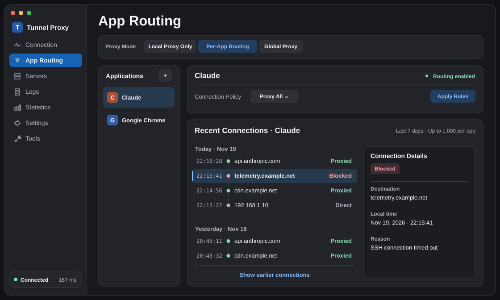

# App Routing 最近连接时间线实施方案

状态为已实现，签名安装后的端到端验收待完成。设计采用 A 的设置与历史双卡片布局，以及 C 的按日时间线和连接详情。

## 现状和目标

路由扩展在当前会话的内存里为每个 App 保留最近 50 条。记录没有按时间过期，扩展停止后会丢失。主程序的心跳每约 5 秒向扩展请求当前选中 App 的记录，控制器只保存最近一次回包。切换 App 时，视图先按新选中项筛选旧回包，可能在下一次心跳前误显示「暂无最近连接」。事件已经包含记录时间，视图尚未展示。

本次让每个 App 的历史可以独立查看，切回时立即显示已加载的记录，主程序或扩展重启后也可查询仍在保留范围内的记录。代理、阻断和直连的判定继续通过现有路由路径执行。

## 界面与交互

- 上方是当前 App 的规则卡片，下方是该 App 的 Recent Connections 卡片。点击左侧 Claude、Google Chrome 等应用时，两张卡一起切换。规则卡继续提供现有的启停、连接策略、域名及应用规则操作。
- 最近连接卡左侧是纵向时间线，最新在上，以 Mac 本地日期分组。当天和前一天显示「今天」「昨天」及日期，更早显示日期。每条显示秒级本地时间、目标和实际走向。彩色节点与文字一起标识代理、阻断和直连。
- 点选一条记录后，下方卡片的右栏显示该条的完整本地日期和时间、完整目标地址、实际走向和已有的失败或放行原因。长域名和 IPv6 在时间线上可截断，在详情里应可完整阅读和复制。无详情选中时提示用户选择一条记录。
- 首次打开某个 App 时显示加载状态，查询成功且列表为空才显示「暂无最近连接」。切回已加载的 App 时先显示缓存，再后台刷新。查询失败时保留该 App 已显示的有效记录并提示刷新失败。扩展停止时，已保存的记录仍可读取。
- 默认查询最新 50 条，底部「查看更多」继续往前翻。刷新保留当前选中事件和阅读位置。切回某个 App 时，如上次选中的记录仍已加载，则恢复详情。
- 默认宽度下并排显示时间线和详情。空间不足时，详情移到时间线下方，选中记录后提供「查看连接详情」跳转按钮。验证现有默认和最小窗口的可读性、键盘选择、VoiceOver、深浅外观和中英本地化。

## 保留规则与数据范围

建议默认保留**最近 7 天，每个 App 最多 1,000 条**，在历史卡标题区显示限制。7 天按事件时刻向前滚动计算，时间线按本地日历分组。两项限制同时生效，活跃 App 到达条数上限后会提前淘汰最旧记录。最近连接记录时间是结果被记录的时刻：代理成功对应连通，阻断对应失败判定，直连对应扩展放行判定。

沿用当前已经生成的事件，保存事件 ID、App 身份、时间、目标主机或 IP、走向与原因。未配置的 App 继续直接走系统网络。关闭该 App 的路由或退出 Per-App Routing 模式后，已有历史继续按保留规则过期。建议移除 App 时从界面隐藏该 App 的历史，底层记录按同一规则过期；若期限内重新加入同一签名身份，可重新看到仍有效的记录。

[原 App Routing 实施方案](app-routing-implementation.md)采用会话内存缓冲、退出及移除时清空的策略。本方案按本节更新留存口径。访问目标和时间线详情里已有的 TCP 诊断字段写入本机专用历史库。系统扩展的待同步记录和主程序的历史库分别位于各自用户的 App Group 容器。规则文件、常规日志、统计和 CSV 导出继续沿用各自现有的数据范围。升级前的内存记录随旧扩展会话结束而消失。

## 实施步骤

1. **新增 SQLite 历史存储。** [Apple DTS 说明](https://developer.apple.com/forums/thread/133761)系统扩展以 root 运行时，和登录用户的主程序解析到各自的 App Group 容器。扩展在自己的容器内保留待同步记录，主程序通过现有的 Network Extension 消息通道分批拉取所有已配置 App 的事件，并写入当前用户的历史库。规则配置携带稳定的本地同步标识，扩展按标识隔离待同步批次。主程序提交事务后才确认事件，扩展收到确认后才删除对应记录。以事件 ID 去重，允许中断后重试。
2. **接入事件生产和清理。** 在 `AppRoutingProvider.remember` 的会话检查后，把现有事件送入有界后台队列，批量追加并在事务内执行清理。主程序与扩展各自运行时定期清理，查询同时过滤已过期记录。扩展停止时尽量提交待写入批次，尚未同步的已提交记录在下次启用分流时补取。存储失败时记录不含目标地址的诊断信息，连接判定和中继继续运行。
3. **独立管理历史读取。** `AppRoutingController` 在后台按 App 分页读库，按事件时间和 ID 稳定排序，使用事件作为分页游标。查询结果只更新所属 App，移除 App 会丢弃其在途查询结果。App Routing 可见时刷新当前 App，离开页面时停刷新。历史数据与会话、规则和隧道状态采用独立的消息类型，同步来源与当前选中的 App 无关。
4. **实现时间线和详情。** 更新 `AppRoutingView` 与中英 `AppRouting.strings`。使用系统日历、时区和日期格式，按结果文字和节点颜色展示走向。保留两张卡片的独立布局，追加较旧记录时保持滚动位置。

## 验收

| 场景 | 通过条件 |
| --- | --- |
| 快速切换 App | 给 Claude 和 Chrome 分别产生事件后，在一次心跳周期内来回切换。已加载的历史立即出现，首次加载有明确状态，晚到的结果不会串到另一 App。 |
| 时间与详情 | 跨午夜的事件按本地日期正确分组。相同时刻的事件排序稳定。点选阻断记录后，详情显示完整时间、目标和失败原因。 |
| 重新打开与离线 | 停止和重启路由扩展，退出并重新打开主程序。已写入主程序历史库且未过期的历史仍可查看。扩展停止时可分批加载旧记录。扩展中尚未同步的批次在重新启用后补取。 |
| 7 天和条数上限 | 用受控时间验证超过 7 天的事件不可见。向 Chrome 写入 1,001 条后仅保留其最新 1,000 条，Claude 的记录不受影响。 |
| 分页和实时刷新 | 加载下一批期间追加新事件。历史不重复、不漏掉仍在保留范围内的记录，选中项和阅读位置稳定。 |
| 规则、移除和数据范围 | 变更规则只影响现有路由机制所处理的新连接。移除后时间线从界面消失；同一签名身份在期限内重新添加时按本方案恢复历史。未配置 App 的目标不入库，目标地址不进入其他日志和导出。 |
| 存储失败与界面可用性 | 模拟数据库不可用时，路由按既有策略工作，历史区可区分读取失败与空列表。在默认和最小窗口检查域名、IPv6、键盘、VoiceOver、浅深色及中英文。 |

## 实施验证

- Debug 签名构建和 Release 未签名编译通过。已读取签名产物，确认主程序和扩展的 App Group entitlement 一致。
- `bash tests/run-routing-checks.sh --relay` 通过，覆盖历史重开、日期过期、每 App 上限、并发插入后的分页范围、待同步批次的持久化与重试，以及现有回环 SOCKS 中继。
- 仍需用安装后的签名应用验收系统扩展激活、两个进程的实际容器访问、真实连接同步以及窗口交互。
