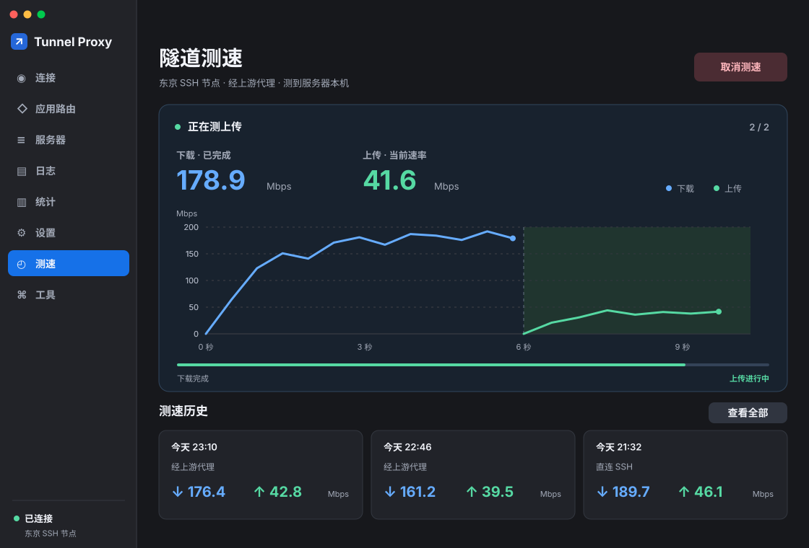

# TunnelProxy 隧道测速方案

状态：待实现。第一版在 macOS App 中增加手动测速，使用当前已连接的 SSH 会话，给出应用层下载和上传速率。先在一台可管理的 SSH 服务器上验证，再为其他服务器配置节点。

## 测速节点与连接路径

| 模式 | 路径 | 用途 |
| --- | --- | --- |
| 隧道测速（第一版） | Mac → TunnelProxy 本地 SOCKS5 → 当前 SSH 会话 → SSH 服务器本机测速服务 | 比较同一连接的表现，或比较不同 SSH 服务器。结果包含 SSH 传输本身和实际采用的上游代理路径 |
| 公网测速（后续） | Mac → 同一个本地 SOCKS5 → 当前 SSH 会话 → SSH 服务器公网出口 → 固定 HTTPS 测速节点 | 检查从该出口访问指定公网节点的速度，结果同时受出口线路和测速节点影响 |

OpenSSH 的 `-D` 会通过服务端连接目标。第一版测速服务绑定在 **SSH 服务器**的 `127.0.0.1`，客户端通过 SOCKS5 请求该地址，服务器无需开放额外的公网端口。SSH 账户需要允许 TCP 转发到该端口。公网模式可复用测速流程，优先选可控的固定节点。两种模式的结果分别标明目标，方便复测。

界面的「Connection path」描述 SSH 自身的接入路径，例如经 `127.0.0.1:7890` 的上游代理。测速请求指定 TunnelProxy 为当前会话创建的 SOCKS5 入口。「Throughput」继续展示隧道已有流量的实时速率，主动测速独立统计自己的有效载荷。参考 [现有隧道与健康检查](../TunnelProxy/Controllers/TunnelEngine.swift)、[实时采样](../TunnelProxy/Controllers/SpeedMonitor.swift) 和 [OpenSSH 动态转发](https://man.openbsd.org/ssh.1)。

## 服务端

- 用轻量 HTTP 服务监听 `127.0.0.1`，部署时通过 SSH 服务器配置指定端口。为每个 SSH profile 增加可选测速端口，已有配置缺少该字段时视为未配置。
- `GET /download?bytes=N` 返回 `Content-Length: N` 的二进制流。分块循环使用预生成的高熵数据块，块大小应超过 SSH 压缩窗口，避免测到可压缩数据的虚高速度。关闭 HTTP 内容压缩和缓存。
- `POST /upload` 接收带 `Content-Length` 的二进制请求，流式读取并丢弃。完整读完后返回 `{"receivedBytes": N}`。大小不符、超限或读超时按失败处理。
- 两个方向均限制单请求字节数、传输时长和并发数。服务进程使用普通权限，不保存请求内容。原型可参考 LibreSpeed 的下载数据生成和上传接收方式。 [LibreSpeed 后端说明](https://github.com/librespeed/speedtest/blob/master/doc.md)

## 客户端与测量口径

1. 从 `TunnelEngine` 获取已连接的会话标识、实际 SOCKS5 监听端口、当前服务器和实际接入路径。启动前确认监听器属于该会话，并将目标端口和会话信息固定到本轮测速。连接状态变化、重连、更换服务器或退出时取消本轮，检查会话标识后再发布结果。
2. 复用现有 `/usr/bin/curl` 的子进程机制，测速执行器单独处理超时、取消和结构化结果。curl 首参数用 `-q` 禁用用户配置，显式传入 `--proxy socks5h://127.0.0.1:<当前 SOCKS 端口>` 和 `--noproxy ""`，且不跟随重定向。每次请求只使用这条路径。下载丢弃响应体并读取传输统计，上传从有界的临时载荷文件读取，结束后清理文件。 [curl 参数文档](https://curl.se/docs/manpage.html)
3. 先下载再上传，每个方向保持一个请求在途。各方向先跑一次小规模探测，根据速率选取预计传输约 5 秒的样本。首版建议各方向总流量上限 64 MiB（含探测），单次请求硬超时 10 秒。用完整样本计算结果。很快触及字节上限时标记为短样本。探测或正式样本超时时给出失败状态，可单独保留已成功的另一方向。
4. `Mbps = 有效载荷字节数 × 8 ÷ 请求耗时（秒） ÷ 1_000_000`。下载要求 HTTP 成功且完整接收预期字节数。上传要求 HTTP 成功且服务端确认字节数与请求一致。请求耗时包含代理转发建连和响应确认，结果代表这条路径的单连接有效传输速率。SSH 握手延迟沿用现有独立指标。

## 界面 · B 实时测速工作台

在「连接」页增加独立的「开始测速」按钮。点击后进入测速工作台并开始本轮测试。工作台顶部显示服务器、实际接入路径和测速目标，并提供「返回连接」。

- **测速中**：先下载、后上传。主图横轴为本轮经过的秒数，纵轴为 Mbps，蓝色表示下载、绿色表示上传。执行器每秒采样实际传输字节，用相邻样本之差绘制速率。已完成方向显示最终速率，进行中的方向显示当前速率。顶部提供「取消测速」。
- **测速结束**：保留本轮曲线和已完成方向的结果，允许「重新测速」。若仅完成一个方向，标记为部分完成。
- **测速历史**：工作台底部展示最近三次记录，点击「查看全部」打开完整历史。记录保存到本机，可跨 App 重启查看，包含时间、服务器、测速目标、实际接入路径和上下行结果。

已连接且当前服务器已配置节点时可开始，同一时间只允许运行一轮。未连接、未配置节点、节点不可达、连接变化、超时和用户取消使用可区分的状态。界面文案覆盖简体中文和英文。

## 实施顺序与验收

1. 在可控 SSH 服务器上部署回环节点，用当前隧道手动验证下载和上传。核对服务端收发字节。断开隧道后重发同一个 SOCKS 请求，应直接失败。使用非默认 SOCKS 端口、`NO_PROXY=*` 和自定义 curl 配置复测，确认仍走 App 的监听器。
2. 接入 `TunnelEngine`、连接页按钮和测速工作台。在 Local Proxy Only 下分别验证 SSH 直连和经上游代理的路径。两种情况下结果均显示本轮的实际路径和服务器。确认图表按传输阶段更新，完整历史在重启后仍可打开。
3. 用已知限速的测试链路核对上下行量级、计量单位和载荷字节数。覆盖短样本、上传确认字节不匹配、服务不可达、超时和服务端拒绝。确认流量上限包含探测请求。
4. 分别在上传、下载期间触发取消、断线和自动重连，确认子进程退出、临时文件清理、本轮结果不会归到新会话，并且可以正常重测。完成 macOS Debug 构建和测速界面手工验收。
5. 第一版跑通后再评估固定公网节点。用同一 SSH 会话先跑本机节点、再跑公网节点，辅助定位出口问题。比较时记录节点和路径，两次速率的差值不直接代表出口带宽。
